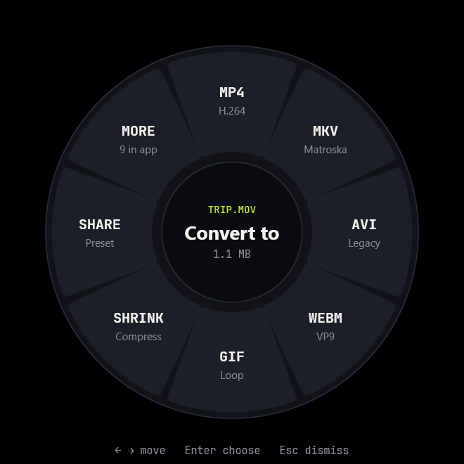
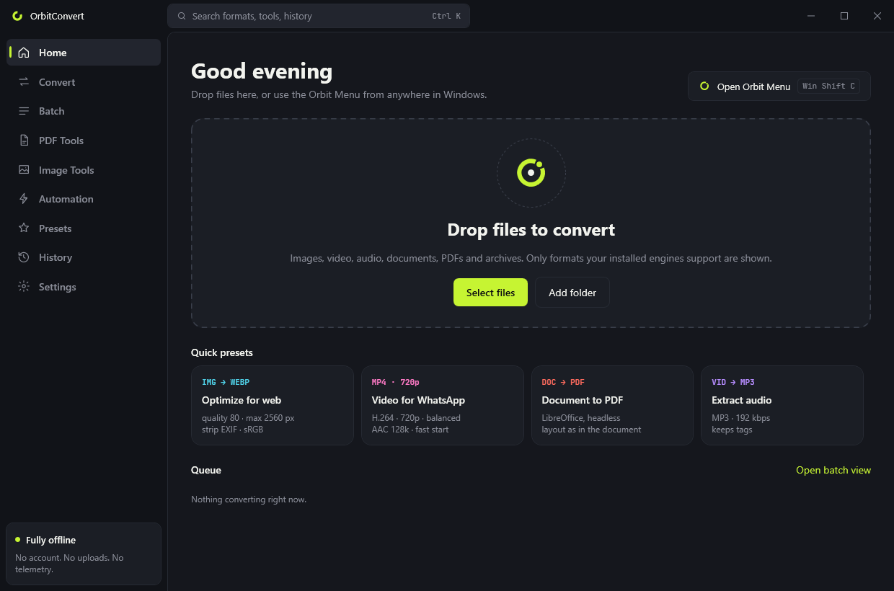
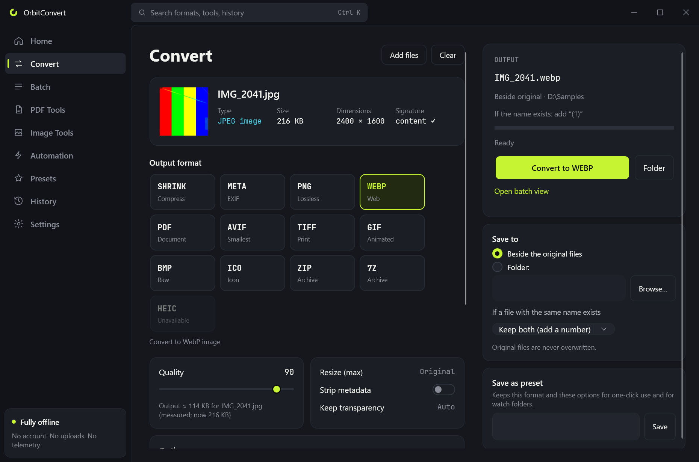
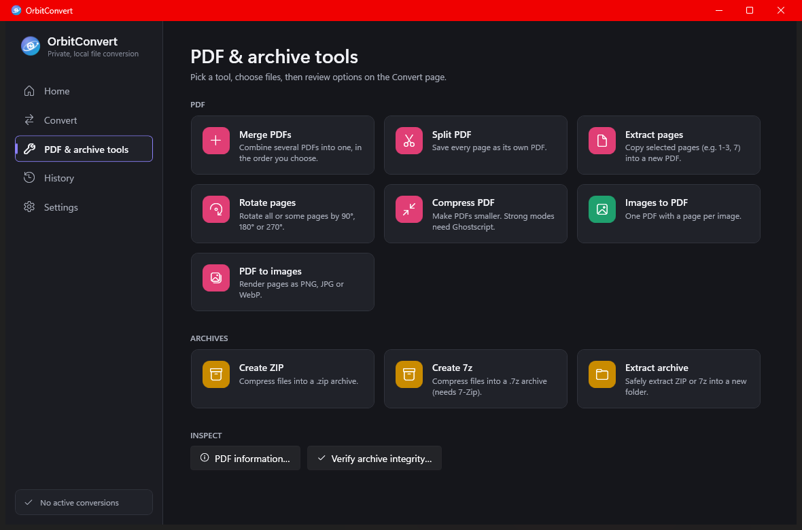
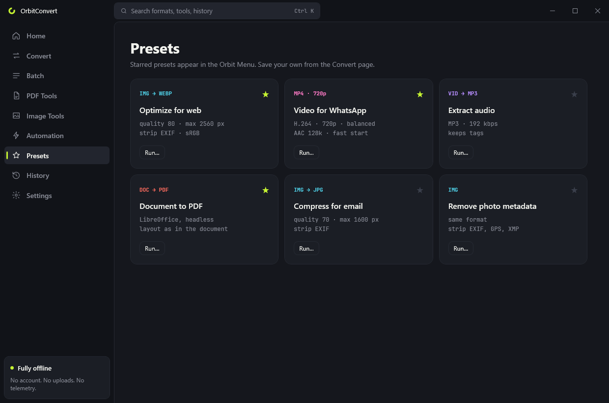
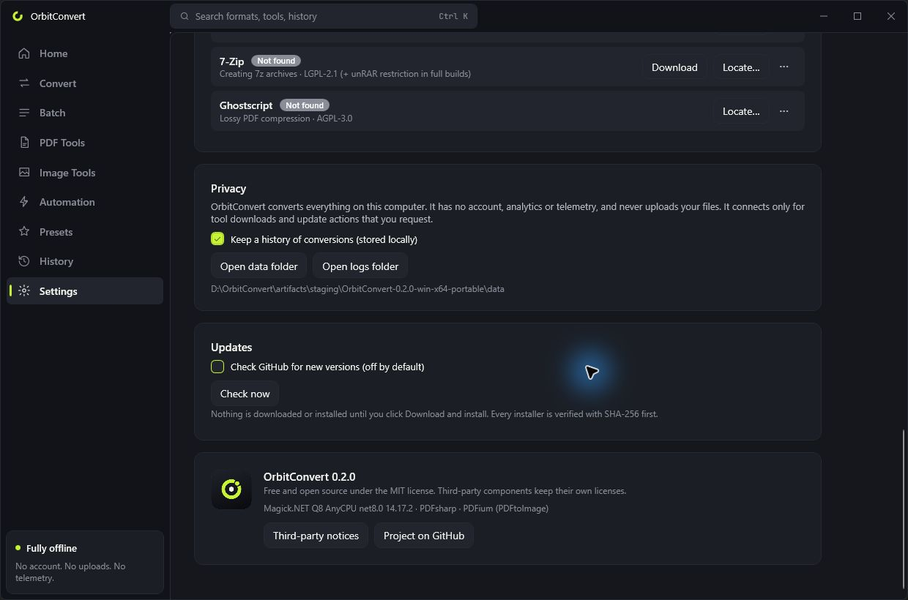

<p align="center">
  
</p>

<h1 align="center">OrbitConvert</h1>

<p align="center">
  Free, private, open-source file conversion for Windows — right from File Explorer.
</p>

<p align="center">
  
  <a href="https://github.com/AbdlrhmanDev/OrbitConvert/actions/workflows/build.yml"></a>
  <a href="https://github.com/AbdlrhmanDev/OrbitConvert/actions/workflows/test.yml"></a>
  <a href="LICENSE"></a>
  <a href="https://github.com/AbdlrhmanDev/OrbitConvert/releases"></a>
</p>

OrbitConvert converts images, video, audio, documents, PDFs and archives **entirely on your computer**.
Pick files in File Explorer, choose a format from a floating radial menu, and the converted file appears
next to the original. A full desktop app handles batches, options, PDF tools and history.

No account. No uploads. No telemetry.

<p align="center">
  <a href="https://github.com/AbdlrhmanDev/OrbitConvert/releases/latest"><strong>Download the latest Windows release</strong></a>
</p>

## Download

### Windows installer (recommended)

The installer is the easiest option. It adds OrbitConvert to the Start menu and File Explorer.

1. Go to the [latest release](https://github.com/AbdlrhmanDev/OrbitConvert/releases/latest).
2. Under **Assets**, choose the installer for your PC:
   - Most Windows PCs: download the file ending in **`win-x64.msi`**.
   - Windows on ARM: download the file ending in **`win-arm64.msi`**.
3. Double-click the downloaded MSI and follow the setup steps. Administrator rights are not required.
4. Open **OrbitConvert** from the Windows Start menu.

> **Windows SmartScreen:** releases are not code-signed yet, so Windows may show **Unknown publisher**.
> Download only from this repository, verify the checksum if needed, then select
> **More info → Run anyway**.

### Portable version

Choose the portable ZIP if you do not want to install the app:

1. Open the [latest release](https://github.com/AbdlrhmanDev/OrbitConvert/releases/latest).
2. Under **Assets**, choose the portable file for your PC:
   - Most Windows PCs: download the file ending in **`win-x64-portable.zip`**.
   - Windows on ARM: download the file ending in **`win-arm64-portable.zip`**.
3. Right-click the ZIP, select **Extract All**, then open the extracted folder.
4. Run **`OrbitConvert.exe`**.

The portable build includes everything needed to run; .NET is not required. It does not automatically
add Start menu shortcuts or File Explorer integration.

### After installation

Images, ZIP files and core PDF tools work immediately. For video, audio, document, 7z or advanced PDF
conversion, open **Settings → Conversion tools** and download the tool shown beside that format.

<p align="center">
  
  
</p>

## Features

- **Orbit Menu**: a radial menu near the cursor that shows only the formats your files can actually become, with
  live progress and a success/failure state. Keyboard: arrows/Tab to move, Enter to convert, 1–9 to
  pick, Esc to close.
- **Four ways to open it**
  - **File Explorer context menu**: “Convert with OrbitConvert” (and a **Send to** entry).
  - **Global shortcut** (default <kbd>Win</kbd>+<kbd>Shift</kbd>+<kbd>C</kbd>) for the files selected
    in the active File Explorer window.
  - **Floating drop zone**: drag files onto a small always-on-top circle.
  - **Shake while dragging** *(experimental, off by default)*: shows a temporary drop target.
- **Real conversions** through proven engines: ImageMagick (bundled), FFmpeg, Pandoc, LibreOffice and
  7-Zip. Nothing is "converted" by renaming extensions. Every output is checked before it is saved.
- **Content-based detection**: files are identified by their bytes, not their extension, and a
  mismatched extension is flagged.
- **Batch processing** with bounded parallelism, a different target and options for every file, pause/resume for waiting
  jobs, cancel, retry and reorder (for PDF merging).
- **PDF tools**: merge, split, extract, thumbnail reorder/remove/rotate, compress, local OCR, images → PDF and PDF → images.
- **Image tools**: crop and backgrounds plus a live editor for resize, flip, brightness, contrast,
  flattened text/arrows/shapes, permanent pixel redaction, and selective EXIF/GPS inspection/removal.
- **Presets**: six built-ins (e.g. "Optimize for web", "Video for WhatsApp") plus your own, saved from
  the Convert page. Starred presets appear in the Orbit Menu for files they apply to.
- **Watch folders** *(off until you turn one on)*: convert new files in a folder with a preset. Files
  are processed only after they stop growing; temporary downloads and OrbitConvert's own outputs are
  ignored.
- **Search** (<kbd>Ctrl</kbd>+<kbd>K</kbd>) across pages, tools, presets and recent history.
- **Measured size estimates**: for images, the Convert page encodes the first file in memory with your
  settings and shows the real output size before you start.
- **Archive tools**: create ZIP/7z, safe extraction (path-traversal and zip-bomb protection), integrity
  checks.
- **Safe by default**: originals are never overwritten; outputs appear atomically; failed or canceled
  conversions leave nothing behind; child processes are killed with their job object.
- **Media editing**: precise start/end trimming and MKV subtitle copy/drop/track selection.
- **English and Arabic** UI with proper RTL layout, light/dark themes, notifications, and a command-line tool.

## Screenshots



| Convert | Orbit Menu |
|---|---|
|  |  |
| **PDF tools** | **Presets** |
|  |  |
| **Settings** | |
|  | |

All screenshots are of the real application (dark theme, Windows 11).

## Supported conversions

What appears depends on what is installed. Unavailable targets are shown disabled with the reason.

| Category | From | To | Engine |
|---|---|---|---|
| Images | JPG, PNG, WebP, BMP, TIFF, GIF, HEIC/HEIF, AVIF, ICO | JPG, PNG, WebP, BMP, TIFF, GIF, AVIF, ICO, PDF; HEIC when the bundled writer passes a real encode probe | ImageMagick (bundled) |
| Video | MP4, MKV, MOV, AVI, WebM, GIF | MP4, MKV, MOV, AVI, WebM, GIF; “Compress” (same format, smaller) | FFmpeg |
| Audio | MP3, WAV, FLAC, AAC, OGG, M4A, Opus — and the audio track of any video | MP3, WAV, FLAC, AAC, OGG, M4A, Opus | FFmpeg |
| Documents | Markdown, HTML, DOCX, ODT, EPUB, TXT | DOCX, HTML, Markdown, ODT, EPUB, TXT | Pandoc |
| Documents | DOCX, DOC, ODT, RTF, TXT, HTML | PDF; DOCX ↔ ODT; DOC/RTF → DOCX, ODT, TXT | LibreOffice |
| Documents | Markdown, EPUB | PDF | Pandoc + LibreOffice |
| PDF | PDF | DOCX — **experimental**, see limitations | LibreOffice |
| PDF | PDF | Merge, split, extract, reorder/remove/rotate, compress, OCR, PNG/JPG/WebP pages | PDFsharp + PDFium; Ghostscript for OCR/lossy compression |
| PDF | Images | One PDF (a page per image) | Bundled |
| Archives | Any files | ZIP (bundled), 7z (7-Zip) | |
| Archives | ZIP, 7z | Extract to a folder, verify integrity | Bundled |

**Options**: image quality, resize (never upscales), crop, rotate, metadata removal, sRGB conversion,
transparency background; video resolution presets, quality, codec (H.264, H.265, VP9, AV1), frame rate,
trim and subtitles, audio removal, GIF frame rate/width; audio bitrate, trim, sample rate, channels; PDF page ranges, rotation,
render DPI, compression level; archive name and compression level.

**Not supported** (and not pretended): editable reconstruction of scanned PDFs, password-protected PDFs
and archives, DRM-protected media. HEIC output stays disabled unless a real sample encode succeeds.

## Verify a download

Keep the MSI and `SHA256SUMS.txt` in the same folder, then run:

```powershell
(Get-FileHash .\OrbitConvert-*-win-x64.msi -Algorithm SHA256).Hash.ToLower()
```

The result must match the MSI entry in `SHA256SUMS.txt`.

## Update or uninstall

- **Update:** open **Settings → Updates → Check now → Download and install**. OrbitConvert downloads
  the new MSI only after you click, verifies SHA-256, closes itself and starts Windows Installer.
- **Uninstall:** open **Windows Settings → Apps → Installed apps → OrbitConvert → Uninstall**.

Uninstalling removes the app, shortcuts and Explorer integration. Settings, history and downloaded
tools remain in `%LOCALAPPDATA%\OrbitConvert`; delete that folder too if you want a complete reset.

### System requirements

- Windows 10 or Windows 11, 64-bit (x64 or ARM64), on a version still supported by .NET 10
- About 300 MB of disk space, plus space for optional tools (FFmpeg ≈ 300 MB unpacked)

## Use it

- **From File Explorer**: right-click files → *Convert with OrbitConvert* (Windows 11: *Show more
  options* first), or *Send to → OrbitConvert*, or select files and press <kbd>Win</kbd>+<kbd>Shift</kbd>+<kbd>C</kbd>.
- **From the app**: drop files on the window, pick a target, adjust options, press *Start conversion*.
- **Batch**: add many files for one shared target, or enable **Different target and options for each file**
  for a mixed batch. Files already in the target format are skipped.

### Command line

The installer also includes `orbitconvert-cli.exe`, which uses the same engine:

```powershell
orbitconvert-cli detect photo.heic                       # identify by content
orbitconvert-cli targets clip.mov                        # list available conversions
orbitconvert-cli convert photo.heic --to jpg --quality 85 --strip-metadata
orbitconvert-cli convert clip.mov --to mp4 --resolution 720
orbitconvert-cli convert a.pdf b.pdf --to pdf-merge
orbitconvert-cli convert report.pdf --to pdf-extract --pages "1-3, 7"
orbitconvert-cli convert *.wav --to opus --bitrate 128 --jobs 4 --out D:\Converted
orbitconvert-cli pdf-info report.pdf
orbitconvert-cli test-archive backup.zip
orbitconvert-cli tools                                   # which external tools were found
orbitconvert-cli install-tool ffmpeg                     # asks for confirmation first
```

Run `orbitconvert-cli --help` for every option. Exit codes: 0 success, 1 a conversion failed, 2 usage error.

## Build from source

Requirements: Windows 10/11 x64 and the [.NET 10 SDK](https://dotnet.microsoft.com/download/dotnet/10.0).

```powershell
git clone https://github.com/AbdlrhmanDev/OrbitConvert.git
cd OrbitConvert
dotnet build OrbitConvert.sln -c Release
dotnet test OrbitConvert.sln -c Release
dotnet run --project src/OrbitConvert.App          # start the desktop app
pwsh scripts/build-release.ps1                     # MSI + portable ZIP + checksums in artifacts\release
pwsh scripts/build-release.ps1 -Runtime win-arm64  # ARM64 artifacts
```

Integration tests that need FFmpeg, Pandoc, LibreOffice, 7-Zip or Ghostscript are **skipped** (not failed) when the
tool is missing. Point `ORBITCONVERT_TOOLS_DIR` at a folder containing the tools to run them. See
[docs/DEVELOPMENT.md](docs/DEVELOPMENT.md).

## What has been verified

Verified by the maintainers on Windows 11 (build 26300, x64, 150 % scaling, single monitor):

- The solution builds with zero warnings; **248 automated tests pass** (89 core, 131 converter and 28
  integration tests with real FFmpeg 9.0.2, Pandoc 3.12.1, LibreOffice 26.8.1.1, 7-Zip 26.04 and
  Ghostscript 10.08.0).
- The app launches; the radial menu opens from the command line and from the Explorer shell verb, and
  conversions started from it and from the Convert page produce validated files (driven through UI
  Automation).
- The MSI installs without admin rights, registers the context menu, Send To, Start menu and sign-in
  entries, and uninstalls cleanly.

Not yet verified on real hardware: Windows 10, multi-monitor setups with mixed DPI, a physical drag
from Explorer onto the drop zone, the global shortcut against a live Explorer selection, and the
experimental shake gesture. A checklist for these is in [docs/SHELL_INTEGRATION.md](docs/SHELL_INTEGRATION.md#manual-validation-checklist).
Reports are welcome.

## Troubleshooting

| Problem | Fix |
|---|---|
| A format is greyed out | Hover it for the reason. Usually a tool is missing: **Settings → Conversion tools**. |
| No context-menu entry on Windows 11 | It is under **Show more options** (<kbd>Shift</kbd>+<kbd>F10</kbd>). The compact menu needs a signed MSIX package, which this project does not ship yet. |
| Shortcut does nothing | Another app may own it — Settings shows a message. Choose a different key. It only reads selections from File Explorer windows, not the desktop. |
| SmartScreen warning | The binaries are unsigned. Verify the checksum, then choose *More info → Run anyway*. |
| “The file is in use” | Close the program that has the file open, then retry from the queue or History. |
| LibreOffice conversions fail | Install LibreOffice from libreoffice.org; OrbitConvert uses its own private profile, so an open LibreOffice window is fine. |
| PDF compression “could not make it smaller” | The PDF is already compact. Balanced/Strong modes need Ghostscript. |
| Need diagnostics | Logs: `%LOCALAPPDATA%\OrbitConvert\logs` (local only; never sent anywhere). |

## Privacy

OrbitConvert works offline. It never uploads files, has no accounts, analytics or telemetry, and makes
network requests only when **you** download a tool, check for updates, or explicitly download an
update (which is SHA-256 verified before installation). History and logs are stored locally and can be
turned off or deleted in Settings. See [docs/SECURITY.md](docs/SECURITY.md) for details.

## Security

Please report vulnerabilities privately — see [SECURITY.md](SECURITY.md). Do not open public issues for
security problems.

## Contributing

Contributions are welcome: bug reports, translations, new converters and tests. Read
[CONTRIBUTING.md](CONTRIBUTING.md) and the [Code of Conduct](CODE_OF_CONDUCT.md). Architecture overview:
[docs/ARCHITECTURE.md](docs/ARCHITECTURE.md); adding a converter: [docs/CONVERTERS.md](docs/CONVERTERS.md).

## Roadmap

Highlights from [docs/ROADMAP.md](docs/ROADMAP.md): signed releases and an MSIX package with a
Windows 11 top-level context-menu entry, more translations and document routes.

## License

OrbitConvert's source code is under the [MIT License](LICENSE). Binary releases bundle third-party
components under their own licenses (including LGPL and MPL libraries inside ImageMagick's native
DLL); optional tools such as FFmpeg (GPL build), Pandoc (GPL) and Ghostscript (AGPL) are not bundled.
See [NOTICE.md](NOTICE.md) for the full list, versions and obligations.

OrbitConvert is an independent project inspired by the interaction style of radial file converters on
other platforms. It does not contain code, artwork or branding from any of them.
